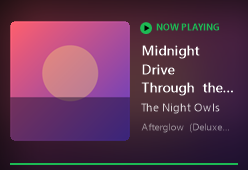

# v1.0.0 · Hello, keyboard

The first release. We all know iCUE sucks, so here's a tiny tray app that shows what's playing on the VANGUARD AIR 99 screen, and does nothing else.

- **The card:** cover, title, artist, album and play/pause, on the keyboard's 248×170 screen.
- **Spotify first:** or any app that tells Windows what's playing.
- **Hands off:** never touches your lighting, macros, key assignments or profiles.
- **Easy on the flash:** one write per song, never more than once every 3 seconds.
- **Leaves no trace:** Exit puts your old screen back.
