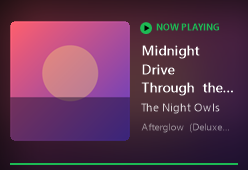

# v1.0.3 · Knows when to step aside

### What's new

- **Idle timer.** Pause or stop the music, and after 60 seconds your own screen comes back. Press play and the card returns. Pick any number of seconds from the tray menu: **Restore my screen when idle → after 60 seconds…**
- **Follows your screen choices.** TrackDeck now checks what's on the screen before taking over and again before putting it back. Picked a new image or GIF in another app? That's the one you get back. Switched screens while the card was up? TrackDeck leaves it alone.

**Full changelog:** [v1.0.2...v1.0.3](https://github.com/yourgirljolyne/TrackDeck/compare/v1.0.2...v1.0.3)
