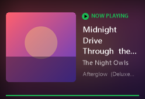

# TrackDeck

**What's playing, on your keyboard. No iCUE required.**



## Why this exists

We all know iCUE sucks. So...

TrackDeck is the alternative: a tiny tray app that shows what Spotify is playing (cover, title, artist, album, play/pause) on the keyboard's screen, and does **nothing else**. It doesn't touch your lighting, your macros, your key assignments or your profiles. It doesn't need iCUE running, installed, or emotionally present.

> Not affiliated with or endorsed by Corsair. The screen protocol was worked out from Corsair's own public Web Hub app. Use at your own risk.

## Get it running

1. Grab `TrackDeck.exe` from [Releases](../../releases), or build it yourself (below).
2. Install the [.NET 10 Desktop Runtime](https://dotnet.microsoft.com/download/dotnet/10.0) if you don't have it.
3. Plug the keyboard in with the **USB cable** and **close iCUE**. Fully. Check the tray. It hides.
4. Run `TrackDeck.exe`. A little green icon appears in the tray. Press play in Spotify.

Change the song, and the screen follows a second or two later.

Right-click the tray icon for the knobs: Spotify only (or any app that tells Windows what's playing), show the paused state, put your old screen back after the music has been paused or stopped for as many seconds as you like, start with Windows. **Exit** puts back whatever screen you had selected (image or GIF), like it was never here.

## How it works

- **Music:** Windows already knows what's playing (it's what powers the media pop-up when you press a volume key). TrackDeck asks Windows, prefers Spotify, and draws a 248×170 card.
- **Connectivity:** it talks to the keyboard over USB using Corsair's "Bragi" protocol, the same one Corsair's browser-based Web Hub uses. The card is saved as an image on the keyboard and the screen is pointed at it.
- **Memory:** the screen reads from the keyboard's flash memory, and flash doesn't love being rewritten 30 times a second. So TrackDeck writes once per song (about 84 KB) and never more than once every 3 seconds.

The nerdy details: [docs/vanguard-screen-protocol.md](docs/vanguard-screen-protocol.md).

## Build it yourself

Needs the .NET 10 SDK on Windows. No NuGet packages, no surprises.

```
cd TrackDeck
dotnet publish -c Release -r win-x64 -o dist -p:PublishSingleFile=true -p:SelfContained=false
```

## Command line

```
TrackDeck list            list the keyboard's USB interfaces (sends nothing)
TrackDeck probe           read the screen's properties (changes nothing)
TrackDeck backup          save the screen files TrackDeck uses to backups\
TrackDeck render x.png    draw the current card to a PNG (add --sample for demo data)
TrackDeck show            put the current card on the screen once
TrackDeck restore         put your previous screen back
TrackDeck screens         list the images and GIFs stored on the keyboard (takes ~30 s)
TrackDeck select <id>     show one of them, e.g. if the wrong screen came back
```

Running `backup` once before you start is a good idea. Peace of mind is free.

## Also in here

[`icue-widget/`](icue-widget) is a TrackDeck widget for **iCUE**'s own widget system, with live updates, a blurred album-art background and a little equalizer. For those who still run iCUE. We don't judge. Much.

## Known limits

- **The screen only updates over the USB cable.** The SLIPSTREAM wireless receiver doesn't pass screen commands on to the keyboard (Corsair's own Web Hub can't reach it wirelessly either). Keep typing wirelessly if you like; TrackDeck just needs the cable plugged in to change the card, and tells you when it isn't.
- Tested on the VANGUARD AIR 99. Other Vanguard models aren't supported yet (they probably speak the same language with a different accent).
- iCUE and TrackDeck will fight over the keyboard. Pick one. (You know which.)

## License

[MIT](LICENSE). Do what you like with it.
